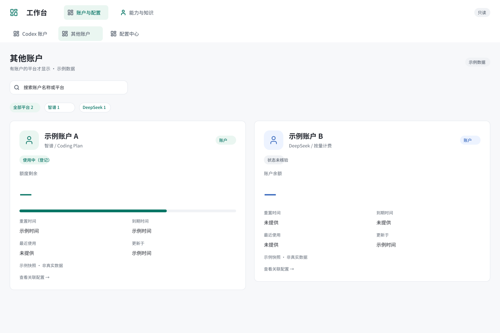

# Codex 工作台

为 Codex 提供统一的本机工作台：浏览和切换账户，查看其他账户与模型服务。



## 功能

| 模块 | 功能 |
| --- | --- |
| Codex 账户 | 添加并登录 Codex 账户，查看额度与重置时间，设置所有会话共用的默认账户 |
| 其他账户 | 按平台筛选账户；后台定期刷新已绑定账户的官方用量；失败保留上次快照 |
| 模型服务 | 按供应商与能力筛选，展示调用验证状态，支持中文名称和 MiniMax 常见拼写检索 |

MCP 只提供一个“工作台”入口，浏览器预览与 MCP 使用同一套服务；账户操作通过明确写入接口完成。页面展示 Codex 账户、其他账户和模型服务的本机公开快照。工作台不提供配置目录、配置查看、解密或编辑接口；已审核知识由独立只读 MCP 能力按需读取。

公开代码不含任何实际账户、模型登记、密码、API Key、登录态、个人业务记录或运行数据库。配置中的字段名与测试中的合成占位值用于说明协议。

详细说明见 [功能手册](docs/features.md) 和 [架构与扩展](docs/architecture.md)。默认账户切换属于显式写操作；官方登录与历史记录保持各自归属。

## 可恢复功能分支

资源中心保存在 `feature/resource-center`，列表分页保存在 `feature/list-pagination`；两者以移除前的稳定主分支为恢复起点。执行记录保存在 `archive/execution-records`。这些分支用于保留实现，恢复时应基于当前开发分支移植对应改动并重新验证，避免直接合并旧快照覆盖后续功能。

## 工作台范围

“工作台”标题独占第一行，下方一行显示“Codex 账户”“其他账户”“模型服务”三个标签页，分别使用绿色、蓝色、紫色选中背景，不再显示单独的模块分组标题。配置中心与知识中心页面已退役，配置与凭据管理由独立模块负责，知识通过只读 MCP 能力提供给 Agent。技能和插件使用 Codex 原生入口查看，工作台不再采集技能目录。工作记录、项目、工作计划和独立工具连接入口及后台服务均不提供。

退役功能恢复分支：`feature/configuration-center`、`feature/knowledge-center`、`feature/workbench-planning`。这些分支仅供参考，恢复前需要按当前契约和权限边界重新适配，不承诺直接可插拔。

独立配置是服务端消费者的输入，工作台只展示账户用量与模型服务的业务投影，不承担配置管理。Codex 默认账户切换只更新账户选择，由会话执行端读取同一份路由约定；切换不修改额度，用量来自真实账户查询。内部引用按稳定标识匹配，不按名称猜测合并。

## 运行

主要使用环境为 macOS。需要 Python 3.11+、已安装并由用户自行登录的官方 Codex CLI；构建界面还需要 Node.js。桌面内嵌页面取决于宿主是否支持 MCP Apps，不能保证所有 Codex 版本均兼容。

```sh
python3 -m venv .venv
.venv/bin/python -m pip install -r requirements.txt
.venv/bin/python launch.py preview
```

预览只监听本机回环地址。新环境没有账户或外部适配器时，相应模块会明确显示为空或来源不可用。

需要将 MCP 注册到自己的 Codex 配置时执行：

```sh
.venv/bin/python install.py
```

安装器会检查同名入口的来源，只更新本项目管理的配置段。注册是显式配置操作；普通页面读取不会安装、登录或改写账户。

可设置 `WORKBENCH_PYTHON` 指定 Python，`WORKBENCH_CODEX_PATH` 指定安装时使用的 Codex CLI，`WORKBENCH_RESOURCES_DIR` 指定非秘密资源目录。直接启动也支持 `--data-dir`、`--resources-dir`、`--codex` 参数。默认活动数据放在本机应用数据目录，不放在仓库。

### 默认账户与继续会话

在 Codex 账户页点击彩色“＋”卡片直接打开官方登录。只有登录成功并自动核验身份后才登记和显示账户；未登录、失败或超时不新增账户卡片。随后可点击“设为默认”。登录材料保留在本机的官方 Codex 独立账户目录；添加账户不会自动改变默认账户。

工作台模型网关实时读取当前默认账户。切换后，同一会话、同一任务轮次中的后续模型调用立即跟随新默认，无需新建任务或会话。已经发送的请求保持其发送时的账户，不中断、重放工具。任务领取时的账户快照用于历史审计，不作为后续请求的固定绑定；旧原生线程仍从原目录续接，上游账户由网关独立选择。默认账户不可用或网关未就绪时明确报错，不静默直连旧账户。

切换接口分别返回偏好保存结果和路由就绪状态。原生配置仍为直连、网关未启动或健康检查失败时，页面明确提示尚未在 Codex 中生效。网关兼容桌面应用官方 CLI 目录迁移，自定义失效路径不会被静默替换。

新准备的网关默认使用 `registered_accounts` 策略，允许新登录并登记的工作台账户动态接入，无需逐个重启网关。已有策略保持不变；从旧版 `fixed` 配置升级并启用动态切换时，显式运行 `WORKBENCH_GATEWAY_ACCOUNT_POLICY=registered_accounts python gateway_control.py prepare`，再运行 `python gateway_control.py start`，并核对设置中的策略与网关健康状态。固定授权仍可通过 `WORKBENCH_GATEWAY_ACCOUNT_POLICY=fixed` 显式选择。HTTP 模式由 Codex 携带完整上下文；跨账户的服务器 `previous_response_id` 引用无法代替上下文，网关会拒绝这种不完整请求而非静默丢失历史。

### 后台快照与账户资料

后台进程按 `refresh-schedule.json` 采集账户、其他账户和模型服务公开列表；知识读取走独立只读 API，不进入页面快照调度。页面仅查询本机快照，手动刷新只加入后台队列。

快照保存在本机数据目录的 `snapshots.json`，原子写入并使用仅当前用户可读写的权限；来源失败保留上次结果。初次没有数据时显示采集中，不将尚未取得的分类统计显示为零。首次官网确认的昵称和头像保存在同目录 `account-profiles.json`，按账户身份与凭据引用匹配，仅在手动更新时改变；未核对的字段保留原值，官网明确不存在的字段通过 `missing_fields` 清除且不从旧快照恢复，不以邮箱冒充昵称。该文件不包含密码、Cookie 或会话材料，也不进入仓库。

### 外部适配器

密钥保险库是可选外部依赖，本仓库不分发用户的私有工具、密文库或主密钥。适配器需要遵循 [接口说明](docs/adapters.md)。缺少适配器时，相应功能不可用；不得把密码写进示例 JSON 代替配置。

MiniMax 用量查询需要显式设置账户的 `usage_credential_id`，指向用户自己的 Token Plan Key。Key 只通过 stdin 交给隔离消费者，查询官方只读套餐接口，不调用付费生成接口。接口没有提供的到期日或最近调用时间保持未知。

仓库中的 `gateway_control.py` 及相关验证脚本是独立、可选的 macOS 工具，不会随只读工作台启动。真实网关认证、账户路由和模型验证必须由使用者另行配置并授权。

网关使用 `WORKBENCH_GATEWAY_ACCOUNT_IDS` 显式指定 JSON 账户白名单，默认仅 `["current"]`，必须包含当前账户且不能重复；部署设置保存该白名单，运行核心要求账户声明与其精确一致。CLI 验收的期望账户由 `WORKBENCH_GATEWAY_EXPECTED_ACCOUNT` 指定，默认 `current`。这些是本机引用，不是登录凭据。

## 开发验证

```sh
PYTHONPATH=src:tests .venv/bin/python -m unittest \
  test_readonly_service test_other_accounts test_account_usage \
  test_api test_mcp test_mcp_resource_isolation test_ui_release \
  test_runtime test_module_catalogs \
  test_credential_details test_credential_probe test_credentials \
  test_install test_titles
.venv/bin/python publish_ui.py
```

`publish_ui.py` 检查 JavaScript、页面状态及加密互操作，再生成 `ui/release.json`。Python 测试使用临时目录和合成数据，不需要真实账户或远端模型。

可选的真实浏览器回归：安装并配置 Playwright/Chromium 后，从仓库根目录运行 `node tests/ui-progress-browser.mjs`。可用 `WORKBENCH_PLAYWRIGHT_MODULE` 指定已有 Playwright 模块、`WORKBENCH_BROWSER_EXECUTABLE` 指定已有浏览器。此检查验证额度条的实际宽度、可见填充色、窄屏和零值／满值状态，使用合成数据。

## 当前版设计

[design/current](design/current/README.md) 是历史设计参考，不代表 1.0.0 当前页面；配置中心截图已标记为退役。当前实现以三页目录和运行时契约为准。

导出图中的账户是通用示例，具体额度、余额和时间均已移除；不包含邮箱、服务器地址、密码或 Key。设计图说明布局与状态，实时数据与新增行为以代码为准。

## 隐私与授权边界

公开分支使用 GitHub noreply 提交邮箱，CI 检查完整可达历史及当前文件的秘密泄漏风险；不导入本机私有历史、旧 UI 副本、验收快照、会话标题映射或 Figma 旧版本。详见 [公开材料检查](docs/publication.md)。

本项目为独立开发的集成工具，并非 OpenAI 官方产品。第三方图标保留原始许可证；见 [素材来源](ui/assets/SOURCES.md)。本仓库暂未单独授予源码的开源许可，公开可见不等于放弃著作权。

## 会话调用与模型验证状态

模型服务读取本机 `model-observations.sqlite3` 中与当前配置匹配的调用终态。成功显示“验证通过”，没有记录显示“未验证”，较新的失败显示“上次验证失败”。状态绑定模型 ID、地址、协议、能力与凭据引用；同一 Key 的其他模型不继承，配置变化后旧结果不适用。更换同一保险库引用中的 Key 时，调用方必须重新核验并记录结果。

会话中的调用可能来自 Shell、外部插件或其他服务，工作台不会仅凭会话完成、模型名称出现、HTTP 200、Key 查询成功或视频任务已受理就认定生成成功，也不自动扫描会话正文。调用方负责在具体模型实际完成生成后登记：

1. 调用前执行 `python record_model_call.py --resources-dir <资源目录> --data-dir <本机数据目录> --model-id <目录模型ID>`，保存返回的配置指纹，并使用该配置调用。
2. 核对实际生成结果后，再执行同一命令，加上 `--outcome verified --fingerprint <调用前的指纹> --observed-at <带时区的实际调用时间>`。实际模型调用失败使用 `--outcome failed`；取消、未发起调用、仅账户查询均不记录。
3. 视频等异步调用必须等最终产物生成成功再记录。补录历史结果必须核对当时连接、模型与凭据引用，不能使用当前配置猜测历史。无法确认的保留未验证。

此命令只记录由调用方核实的结果，不自行验证结果真实性或发起模型请求。记录不包含提示词、回复、服务器地址或 Key，保存在本机数据目录；模型列表、详情与关联服务详情通过同一投影读取，记录变化后下次读取使缓存失效。页面与 MCP 以只读浏览为主；设置默认账户属于明确的本机偏好写操作。

Codex 账户按登记主体分别保存 `account-snapshots/<账户摘要>/profile.json`（首次登录时的公开资料）与 `usage.json`（高频额度）。首屏直接读取已有资料；调度仅刷新额度并保留上次成功值，读取失败显示失败状态。每次额度刷新仍会向官方接口核验当前主体，冻结的显示资料不会参与认证判断。官方 RPC 未提供昵称或头像时，资料状态明确为缺失；首次登录会请求 Codex 从已核对为同一主体的官方页面采集真实名称、账号标识与头像；账户卡片不提供手动更新资料按钮。官网资料保存为本机 `account-profiles.json`，头像使用本地 data URI，页面不加载远端头像。没有官网资料的字段保持缺失，API 凭据不会被当作网页登录态。登录已注销、主体不匹配或登记绑定改变时不复用旧主体数据。首次升级只从有已核验主体绑定证据的公开历史快照恢复显示数据，不恢复认证材料；当前登录账户按主体摘要隔离资料，不能仅凭同一邮箱复用。官网导入需由工作台首次登录申请十分钟内有效的单次授权，切换账户、重复保存及过期请求均会拒绝。
